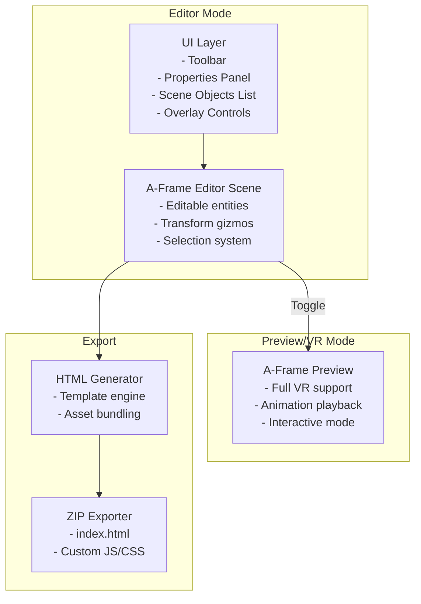

# A-Frame Conversion Plan for Pixel Virtual Studio

Current Status:
✅ Phase 0: VR/AR Buttons
✅ Phase 1: Core A-Frame Integration
✅ Phase 1B: Materials to Mixins
✅ Phase 1C: Example Assets
✅ Phase 2: UI Adaptation
✅ Phase 3: Element Management
✅ Phase 4: Animation/VR Playback (basic)
✅ Phase 5: Export Functionality
⏳ Phase 6: Testing & Refinement

## Overview

This plan outlines the conversion of the existing Three.js-based Pixel 3D Studio to use A-Frame for VR-capable scene creation. The goal is to create a VR editor where users can:
- Add A-Frame elements to a scene
- Play VR object animations
- Edit properties of VR objects via the existing properties panel
- Export scenes as standalone A-Frame HTML files

## Architecture Overview



## Current vs. Target State

| Component | Current (Three.js) | Target (A-Frame) |
|-----------|-------------------|------------------|
| 3D Engine | Three.js | A-Frame |
| Scene Graph | THREE.Scene | A-Scene |
| Objects | THREE.Mesh | A-Entities |
| Materials | THREE.Material | A-Frame material component |
| Lights | THREE.Light | `<a-light>` |
| Camera | THREE.Camera | `<a-camera>` |
| Animations | AnimationMixer | A-Frame animation component |
| Export | JSON scene | HTML + assets |

---

## Complete A-Frame Element Support

Based on the A-Frame examples (a-blast, model-viewer, hand-tracking, UI, panorama, 360-video) and additional elements requested:

### Core Elements

| Element | Tag | Description |
|---------|-----|-------------|
| Scene | `<a-scene>` | Root A-Frame scene |
| Entity | `<a-entity>` | Generic container entity |
| Assets | `<a-assets>` | Asset management system |
| Asset Item | `<a-asset-item>` | Preload assets |
| Mixin | `<a-mixin>` | Reusable component patterns |

### Geometry Primitives

| Element | Tag | Properties |
|---------|-----|------------|
| Box | `<a-box>` | width, height, depth, color |
| Sphere | `<a-sphere>` | radius, segments-width, segments-height |
| Cylinder | `<a-cylinder>` | radius, height, segments-radial |
| Cone | `<a-cone>` | radius-bottom, radius-top, height |
| Plane | `<a-plane>` | width, height, rotation |
| Torus | `<a-torus>` | radius, radius-tubular |
| Torus Knot | `<a-torus-knot>` | radius, radius-tubular, p, q |
| Circle | `<a-circle>` | radius, segments |
| Ring | `<a-ring>` | radius-inner, radius-outer |
| Triangle | `<a-triangle>` | vertex-a, vertex-b, vertex-c |

### Media Elements

| Element | Tag | Properties |
|---------|-----|------------|
| Image | `<a-image>` | src, width, height |
| Video | `<a-video>` | src, width, height, loop |
| 360 Image | `<a-sky>` | src, color |
| 360 Video | `<a-videosphere>` | src |
| Audio | `<a-sound>` | src, autoplay, loop, volume |

### Environment

| Element | Tag | Properties |
|---------|-----|------------|
| Environment | `<a-entity environment>` | preset, sky-type, lighting |
| Sky | `<a-sky>` | src, color |
| Ground | `<a-plane>` (with environment) | - |

### Camera & Controls

| Element | Tag | Properties |
|---------|-----|------------|
| Camera | `<a-camera>` | position, rotation, fov |
| Look Controls | look-controls | reverseMouseDrag, touchEnabled |
| WASD Controls | wasd-controls | acceleration, fly |
| Orbit Controls | orbit-controls | target, minDistance, maxDistance |

### Lighting

| Element | Tag | Properties |
|---------|-----|------------|
| Ambient Light | `<a-light type="ambient">` | color, intensity |
| Directional Light | `<a-light type="direction">` | color, intensity, position |
| Point Light | `<a-light type="point">` | color, intensity, distance |
| Spot Light | `<a-light type="spot">` | color, intensity, angle, penumbra |

### Models

| Element | Tag | Properties |
|---------|-----|------------|
| GLTF Model | `<a-gltf-model>` | src, animation-mixer |
| OBJ Model | `<a-obj-model>` | obj, mtl |

### Text & UI

| Element | Tag | Properties |
|---------|-----|------------|
| Text | `<a-text>` | value, align, width, color, font |
| Link | `<a-link>` | href, title, image |
| Cursor | `<a-cursor>` | fuse, timeout, color |
| Raycaster | raycaster | objects, far, near |

### Interaction & Physics

| Element | Tag | Properties |
|---------|-----|------------|
| Clickable | Super Hands | - |
| Grabbable | super-hands | - |
| Physics | aframe-physics-system | gravity, debug |
| Event Set | event-set | _events, _set |

### Animation

| Element | Tag | Properties |
|---------|-----|------------|
| Animation | animation | property, to, dur, easing, loop, delay |
| Animation Mixer | animation-mixer | clip, loop, crossFadeDuration |

### Hand Tracking

| Element | Tag | Properties |
|---------|-----|------------|
| Hand | `<a-entity hand-controls>` | hand, handModelStyle |
| Hand Tracking | hand-tracking-controls | hand, handModelStyle |

---

---

## Phase 0: VR/AR Fullscreen Button & JavaScript Behaviors ✅ COMPLETE

### VR/AR Mode Fullscreen Button

Add a prominent VR/AR mode button to enter immersive mode.

**Implementation Status:** ✅ COMPLETE
- Added VR and AR buttons to header in [`index.html:77-79`](index.html:77)
- Event handlers in [`js/main.js:773-805`](js/main.js:773)
- Keyboard shortcut F5 for VR

**UI Placement:** Header controls area

```html
<button class="btn vr-btn" id="btn-enter-vr" title="Enter VR (F5)">
    <i class="fas fa-vr-cardboard"></i> Enter VR
</button>
<button class="btn vr-btn" id="btn-enter-ar" title="Enter AR">
    <i class="fas fa-mobile-alt"></i> Enter AR
</button>
```

**Implementation:**
```javascript
// Enter VR mode
document.getElementById('btn-enter-vr').addEventListener('click', () => {
    const scene = document.querySelector('a-scene');
    if (scene.is('vr-mode-available')) {
        scene.enterVR();
    }
});

// Enter AR mode
document.getElementById('btn-enter-ar').addEventListener('click', () => {
    const scene = document.querySelector('a-scene');
    if (scene.is('ar-mode-available')) {
        scene.enterAR();
    }
});

// Keyboard shortcut
document.addEventListener('keydown', (e) => {
    if (e.key === 'F5') {
        document.getElementById('btn-enter-vr').click();
    }
});
```

---

## Phase 1: Core A-Frame Integration ✅ COMPLETE

### 1.1 Update HTML Entry Point

**Implementation Status:** ✅ COMPLETE
- A-Frame library added in [`index.html:56`](index.html:56)
- A-Frame Extras in [`index.html:59`](index.html:59)
- Environment component in [`index.html:62`](index.html:62)
- A-Frame scene container in [`index.html:279-292`](index.html:279)

```html
<!-- Core A-Frame -->
<script src="https://aframe.io/releases/1.5.0/aframe.min.js"></script>

<!-- A-Frame Extras (animation-mixer, controls) -->
<script src="https://cdn.jsdelivr.net/gh/c-frame/aframe-extras@7.2.0/dist/aframe-extras.min.js"></script>

<!-- Environment Component -->
<script src="https://unpkg.com/aframe-environment-component@1.3.3/dist/aframe-environment-component.min.js"></script>

<!-- Super Hands (interaction) -->
<script src="https://unpkg.com/super-hands@3.0.4/dist/super-hands.min.js"></script>

<!-- Physics System -->
<script src="https://cdn.jsdelivr.net/gh/c-frame/aframe-physics-system@v4.2.2/dist/aframe-physics-system.min.js"></script>

<!-- Event Set Component -->
<script src="https://unpkg.com/aframe-event-set-component@5.0.0/dist/aframe-event-set-component.min.js"></script>

<!-- Look At Component -->
<script src="https://unpkg.com/aframe-look-at-component@0.8.0/dist/aframe-look-at-component.min.js"></script>
```

### 1.2 Create A-Frame Scene Manager

**Implementation Status:** ✅ COMPLETE
- Created [`js/aframeSceneManager.js`](js/aframeSceneManager.js)
- Scene management, entity selection, VR/AR modes implemented
- Asset management, play/stop animations methods added

### 1.3 Create A-Frame Entity Factory

**Implementation Status:** ✅ COMPLETE
- Created [`js/aframeFactory.js`](js/aframeFactory.js)
- Supports all A-Frame element types (primitives, media, models, environment, etc.)

---

## Phase 1B: Materials to Mixins System ✅ COMPLETE

### Overview

**Implementation Status:** ✅ COMPLETE
- Extended MaterialsManager with mixin support in [`js/materialsManager.js`](js/materialsManager.js:430-560)
- Added methods: createMixin, createMixinFromMaterial, applyMixinToSelected, updateAFrameAssets, exportMixinsAsHTML
- Mixins are synced with A-Frame scene's `<a-assets>` container

### Current System Analysis

**File:** `js/materialsManager.js`

Existing functionality:
- Create custom PBR materials
- Apply materials to selected objects
- Store materials in a list
- Material properties: color, metalness, roughness

### Extended Materials Manager

**New File:** `js/materialsMixinsManager.js` (or extend existing)

**Key Changes:**
1. Add A-Frame mixin creation alongside materials
2. Store mixin definitions
3. Apply mixins to selected entities
4. Sync mixin list with `<a-assets>` container

### Mixin Data Structure

```javascript
// Mixin definition
{
    id: 'mixin-123',
    name: 'Red Metal Box',
    type: 'mixin',
    // A-Frame properties
    geometry: {
        primitive: 'box',
        width: 1,
        height: 1,
        depth: 1
    },
    material: {
        color: '#ff0000',
        metalness: 0.8,
        roughness: 0.2
    },
    animation: {
        property: 'rotation',
        to: '0 360 0',
        dur: 2000,
        loop: true
    },
    // Apply to entity via mixin attribute
    applyAs: 'mixin' // or 'class', 'material'
}
```

### Mixin Properties Panel

**Location:** Existing materials section in right panel

**UI Elements:**
1. Toggle between "Materials" and "Mixins" view
2. Mixin creation form:
   - Name input
   - Select base element type (box, sphere, etc.)
   - Geometry properties (width, height, radius, etc.)
   - Material properties (color, metalness, roughness, opacity, src)
   - Animation properties
   - Custom component properties
3. Mixin list with edit/delete
4. "Apply to Selected" button

### Mixin UI Mockup

```html
<!-- Mixins Section (add to existing materials section) -->
<div id="mixins-section" style="display: none;">
    <div class="panel-header">
        <div class="panel-header-title">
            <i class="fas fa-clone"></i> Mixins
        </div>
    </div>
    
    <div class="mixin-controls">
        <button class="btn" id="btn-create-mixin">
            <i class="fas fa-plus"></i> Create Mixin
        </button>
    </div>
    
    <div id="mixins-list" class="mixins-list">
        <!-- Mixin items rendered here -->
    </div>
    
    <!-- Mixin Editor -->
    <div id="mixin-editor" class="mixin-editor">
        <div class="property-group">
            <div class="property-label">Mixin Name</div>
            <input type="text" id="mixin-name" placeholder="My Mixin">
        </div>
        
        <div class="property-group">
            <div class="property-label">Element Type</div>
            <select id="mixin-element-type">
                <option value="box">Box</option>
                <option value="sphere">Sphere</option>
                <option value="cylinder">Cylinder</option>
                <option value="entity">Generic Entity</option>
            </select>
        </div>
        
        <!-- Geometry Properties -->
        <div class="property-group">
            <div class="property-label">Geometry</div>
            <div id="mixin-geometry-props">
                <!-- Dynamic based on element type -->
            </div>
        </div>
        
        <!-- Material Properties -->
        <div class="property-group">
            <div class="property-label">Material</div>
            <label>Color: <input type="color" id="mixin-color" value="#4CC3D9"></label>
            <label>Metalness: <input type="range" id="mixin-metalness" min="0" max="1" step="0.1" value="0"></label>
            <label>Roughness: <input type="range" id="mixin-roughness" min="0" max="1" step="0.1" value="0.5"></label>
            <label>Opacity: <input type="range" id="mixin-opacity" min="0" max="1" step="0.1" value="1"></label>
        </div>
        
        <!-- Animation Properties -->
        <div class="property-group">
            <div class="property-label">Animation</div>
            <label>
                <input type="checkbox" id="mixin-animate-enabled"> Enable Animation
            </label>
            <select id="mixin-animation-property">
                <option value="rotation">Rotation</option>
                <option value="position">Position</option>
                <option value="scale">Scale</option>
                <option value="opacity">Opacity</option>
            </select>
            <label>To: <input type="text" id="mixin-animation-to" value="0 360 0"></label>
            <label>Duration: <input type="number" id="mixin-animation-dur" value="2000"> ms</label>
            <label>
                <input type="checkbox" id="mixin-animation-loop" checked> Loop
            </label>
        </div>
        
        <!-- Custom Components -->
        <div class="property-group">
            <div class="property-label">Custom Components</div>
            <textarea id="mixin-components" placeholder='{"component-name": {"prop": "value"}}'></textarea>
        </div>
        
        <div class="mixin-actions">
            <button class="btn" id="btn-save-mixin">Save Mixin</button>
            <button class="btn" id="btn-apply-mixin">Apply to Selected</button>
        </div>
    </div>
</div>
```

### Implementation Details

#### 1. Mixin Manager Class

```javascript
class MixinsManager {
    constructor(app) {
        this.app = app;
        this.mixins = [];
        this.assetsContainer = null;
    }
    
    // Create mixin definition
    createMixin(data) {
        const mixin = {
            id: 'mixin-' + Date.now(),
            name: data.name || 'New Mixin',
            elementType: data.elementType || 'box',
            geometry: data.geometry || {},
            material: data.material || {},
            animation: data.animation || null,
            components: data.components || {}
        };
        
        this.mixins.push(mixin);
        this.updateAssetsContainer();
        return mixin;
    }
    
    // Apply mixin to selected entity
    applyMixinToSelected(mixinId) {
        const mixin = this.mixins.find(m => m.id === mixinId);
        if (!mixin || !this.app.selectedEntity) return;
        
        const el = this.app.selectedEntity;
        
        // Apply mixin reference
        el.setAttribute('mixin', mixin.name.toLowerCase().replace(/\s+/g, '-'));
        
        // Also apply direct properties if not using mixin
        if (mixin.geometry) {
            el.setAttribute('geometry', mixin.geometry);
        }
        if (mixin.material) {
            el.setAttribute('material', mixin.material);
        }
        if (mixin.animation) {
            el.setAttribute('animation', mixin.animation);
        }
    }
    
    // Update <a-assets> with mixins
    updateAssetsContainer() {
        const scene = document.querySelector('a-scene');
        let assets = scene.querySelector('a-assets');
        
        if (!assets) {
            assets = document.createElement('a-assets');
            scene.insertBefore(assets, scene.firstChild);
        }
        
        // Clear existing mixins
        assets.querySelectorAll('a-mixin').forEach(m => m.remove());
        
        // Add mixins
        this.mixins.forEach(mixin => {
            const mixinEl = document.createElement('a-mixin');
            mixinEl.id = mixin.id;
            
            // Build mixin attributes
            if (mixin.geometry) {
                mixinEl.setAttribute('geometry', mixin.geometry);
            }
            if (mixin.material) {
                mixinEl.setAttribute('material', mixin.material);
            }
            if (mixin.animation) {
                mixinEl.setAttribute('animation', mixin.animation);
            }
            
            assets.appendChild(mixinEl);
        });
    }
    
    // Render mixins list in panel
    renderMixinsList() {
        const container = document.getElementById('mixins-list');
        container.innerHTML = '';
        
        this.mixins.forEach(mixin => {
            const item = document.createElement('div');
            item.className = 'mixin-item';
            item.innerHTML = `
                <i class="fas fa-clone"></i>
                <span>${mixin.name}</span>
                <div class="mixin-actions">
                    <i class="fas fa-edit" data-action="edit" data-id="${mixin.id}"></i>
                    <i class="fas fa-trash" data-action="delete" data-id="${mixin.id}"></i>
                </div>
            `;
            container.appendChild(item);
        });
    }
}
```

#### 2. Convert Existing Materials to Mixins

**Method:** When user creates a material, also offer to create a mixin

```javascript
// In MaterialsManager - add mixin creation
createMaterialAndMixin(materialData) {
    // Create Three.js material (existing)
    const material = this.createMaterial(materialData);
    
    // Also create A-Frame mixin
    if (this.app.mixinsManager) {
        this.app.mixinsManager.createMixin({
            name: materialData.name + ' Mixin',
            elementType: 'box',
            material: {
                color: '#' + materialData.color.toString(16).padStart(6, '0'),
                metalness: materialData.metalness,
                roughness: materialData.roughness
            }
        });
    }
    
    return material;
}
```

#### 3. Toolbar Button for Mixins

**Add to toolbar:**
```html
<div class="tool-btn" id="tool-mixins" data-tooltip="**Mixins**
Manage A-Frame mixins">
    <i class="fas fa-clone"></i>
</div>
```

#### 4. Integration with Export

**Mixin export in HTML:**
```html
<a-assets>
    <!-- Mixins are exported as a-mixin elements -->
    <a-mixin id="mixin-1" 
             geometry="primitive: box; width: 1"
             material="color: #ff0000; metalness: 0.5"
             animation="property: rotation; to: 0 360 0; loop: true">
    </a-mixin>
</a-assets>

<!-- Apply to entity -->
<a-box mixin="mixin-1"></a-box>
```

### Phase 2B: UI Integration

**Modified Files:**
- `js/materialsManager.js` - Extend to support mixins (or create new `js/materialsMixinsManager.js`)
- `index.html` - Add mixin section UI
- `js/ui.js` - Add mixin panel toggle

---

## Phase 2: UI Adaptation ✅ COMPLETE

### 2.1 Modify Toolbar - Add A-Frame Elements Menu

**Implementation Status:** ✅ COMPLETE
- Added A-Frame Elements menu to toolbar in [`index.html:196-235`](index.html:196)
- Categories: Primitives, Media, Text & UI, Models, Environment, Advanced
- CSS styling for categories in [`css/styles.css:1478-1500`](css/styles.css:1478)

```html
<!-- A-Frame Primitives -->
<div class="tool-btn menu-parent" data-tooltip="**Primitives**">
    <i class="fas fa-cube"></i>
    <div class="tool-submenu">
        <div class="tool-btn" data-action="addAFrameElement" data-type="box"><i class="fas fa-cube"></i> Box</div>
        <div class="tool-btn" data-action="addAFrameElement" data-type="sphere"><i class="fas fa-circle"></i> Sphere</div>
        <div class="tool-btn" data-action="addAFrameElement" data-type="cylinder"><i class="fas fa-database"></i> Cylinder</div>
        <div class="tool-btn" data-action="addAFrameElement" data-type="cone"><i class="fas fa-caret-up"></i> Cone</div>
        <div class="tool-btn" data-action="addAFrameElement" data-type="plane"><i class="fas fa-vector-square"></i> Plane</div>
        <div class="tool-btn" data-action="addAFrameElement" data-type="torus"><i class="fas fa-life-ring"></i> Torus</div>
        <div class="tool-btn" data-action="addAFrameElement" data-type="torus-knot"><i class="fas fa-bezier-curve"></i> Torus Knot</div>
        <div class="tool-btn" data-action="addAFrameElement" data-type="circle"><i class="fas fa-circle"></i> Circle</div>
        <div class="tool-btn" data-action="addAFrameElement" data-type="ring"><i class="fas fa-certificate"></i> Ring</div>
        <div class="tool-btn" data-action="addAFrameElement" data-type="triangle"><i class="fas fa-play"></i> Triangle</div>
    </div>
</div>

<!-- A-Frame Media -->
<div class="tool-btn menu-parent" data-tooltip="**Media**">
    <i class="fas fa-photo-video"></i>
    <div class="tool-submenu">
        <div class="tool-btn" data-action="addAFrameElement" data-type="image"><i class="fas fa-image"></i> Image</div>
        <div class="tool-btn" data-action="addAFrameElement" data-type="video"><i class="fas fa-video"></i> Video</div>
        <div class="tool-btn" data-action="addAFrameElement" data-type="sky"><i class="fas fa-cloud"></i> 360 Image</div>
        <div class="tool-btn" data-action="addAFrameElement" data-type="videosphere"><i class="fas fa-video"></i> 360 Video</div>
        <div class="tool-btn" data-action="addAFrameElement" data-type="sound"><i class="fas fa-volume-up"></i> Audio</div>
    </div>
</div>

<!-- A-Frame Models -->
<div class="tool-btn menu-parent" data-tooltip="**Models**">
    <i class="fas fa-cubes"></i>
    <div class="tool-submenu">
        <div class="tool-btn" data-action="addAFrameElement" data-type="gltf-model"><i class="fas fa-cube"></i> GLTF Model</div>
        <div class="tool-btn" data-action="addAFrameElement" data-type="obj-model"><i class="fas fa-cubes"></i> OBJ Model</div>
    </div>
</div>

<!-- A-Frame Text & UI -->
<div class="tool-btn menu-parent" data-tooltip="**Text & UI**">
    <i class="fas fa-font"></i>
    <div class="tool-submenu">
        <div class="tool-btn" data-action="addAFrameElement" data-type="text"><i class="fas fa-font"></i> Text</div>
        <div class="tool-btn" data-action="addAFrameElement" data-type="link"><i class="fas fa-link"></i> Link</div>
        <div class="tool-btn" data-action="addAFrameElement" data-type="cursor"><i class="fas fa-crosshairs"></i> Cursor</div>
    </div>
</div>

<!-- A-Frame Environment -->
<div class="tool-btn menu-parent" data-tooltip="**Environment**">
    <i class="fas fa-tree"></i>
    <div class="tool-submenu">
        <div class="tool-btn" data-action="addAFrameElement" data-type="environment"><i class="fas fa-globe"></i> Environment</div>
        <div class="tool-btn" data-action="addAFrameElement" data-type="light"><i class="fas fa-lightbulb"></i> Light</div>
        <div class="tool-btn" data-action="addAFrameElement" data-type="camera"><i class="fas fa-camera"></i> Camera</div>
    </div>
</div>

<!-- Generic Entity -->
<div class="tool-btn menu-parent" data-tooltip="**Advanced**">
    <i class="fas fa-cogs"></i>
    <div class="tool-submenu">
        <div class="tool-btn" data-action="addAFrameElement" data-type="entity"><i class="fas fa-cube"></i> Generic Entity</div>
        <div class="tool-btn" data-action="addAFrameElement" data-type="assets"><i class="fas fa-box"></i> Assets Container</div>
        <div class="tool-btn" data-action="addAFrameElement" data-type="mixin"><i class="fas fa-clone"></i> Mixin</div>
    </div>
</div>

<!-- VR/Interaction -->
<div class="tool-btn menu-parent" data-tooltip="**VR & Interaction**">
    <i class="fas fa-vr-cardboard"></i>
    <div class="tool-submenu">
        <div class="tool-btn" data-action="addAFrameElement" data-type="hand-controls"><i class="fas fa-hand-paper"></i> Hand Controls</div>
        <div class="tool-btn" data-action="addAFrameElement" data-type="hand-tracking-controls"><i class="fas fa-hand-pointer"></i> Hand Tracking</div>
        <div class="tool-btn" data-action="addAFrameElement" data-type="raycaster"><i class="fas fa-bullseye"></i> Raycaster</div>
    </div>
</div>
```

### 2.2 Add VR Mode Toggle

**Implementation Status:** ✅ COMPLETE
- A-Frame mode button in header in [`index.html:77`](index.html:77)
- Toggle functionality in [`js/aframeSceneManager.js:100-139`](js/aframeSceneManager.js:100)
- Keyboard shortcut F6 for mode toggle

### 2.3 Add Play Button to Overlay Controls

**Implementation Status:** ✅ COMPLETE
- Added Play/Stop buttons to overlay-controls in [`index.html:266-274`](index.html:266)
- CSS styling in [`css/styles.css:1447-1500`](css/styles.css:1447)
- Event handlers in [`js/main.js:790-825`](js/main.js:790)
- Keyboard shortcuts F8 (play) and F9 (stop)
- Methods in [`js/aframeSceneManager.js:437-498`](js/aframeSceneManager.js:437)

### 2.4 Update Properties Panel for A-Frame

**Implementation Status:** 🔄 IN PROGRESS
- Basic entity properties supported in aframeSceneManager
- Integration with existing properties panel pending

---

## Phase 3: A-Frame Element Management ✅ COMPLETE

### 3.1 Scene Objects List (LayerManager Adaptation)

**Implementation Status:** ✅ COMPLETE
- Extended LayerManager in [`js/layerManager.js`](js/layerManager.js:545-670)
- Added `isAFrameMode` flag
- Added `renderAFrameEntities()` method to show A-Frame entities
- Added `getAFrameIcon()` method for entity icons
- Added `setAFrameMode()` to toggle between Three.js and A-Frame views
- Added CSS styling in [`css/styles.css:1502-1530`](css/styles.css:1502)

### 3.2 Selection System

**Implementation Status:** ✅ COMPLETE
- Entity selection integrated in aframeSceneManager
- Layer list updates on entity selection/deselection
- Sync with A-Frame mode toggle

---

## Phase 3B: JavaScript Behaviors (Dreamweaver-style)

Inspired by Adobe Dreamweaver's JavaScript Behaviors, this system allows users to add interactive behaviors to A-Frame entities without writing code.

### Behavior Categories

#### 1. Navigation Behaviors

| Behavior | Description | Code |
|----------|-------------|------|
| **Go To URL** | Navigate to a URL | `window.location.href = 'url'` |
| **Go Back** | Go to previous page | `history.back()` |
| **Go Forward** | Go to next page | `history.forward()` |
| **Open Window** | Open new browser window | `window.open(url, name, features)` |

**UI:**
```html
<div class="behavior-group">
    <div class="behavior-title">Navigation</div>
    <button class="behavior-btn" data-behavior="goto-url">
        <i class="fas fa-external-link-alt"></i> Go To URL
    </button>
    <button class="behavior-btn" data-behavior="go-back">
        <i class="fas fa-arrow-left"></i> Go Back
    </button>
    <button class="behavior-btn" data-behavior="go-forward">
        <i class="fas fa-arrow-right"></i> Go Forward
    </button>
    <button class="behavior-btn" data-behavior="open-window">
        <i class="fas fa-window-restore"></i> Open Window
    </button>
</div>
```

#### 2. Interaction Behaviors

| Behavior | Description | Code |
|----------|-------------|------|
| **Play Sound** | Play audio on click | `el.components.sound.playSound()` |
| **Stop Sound** | Stop audio | `el.components.sound.stopSound()` |
| **Toggle Visibility** | Show/hide element | `el.setAttribute('visible', !el.getAttribute('visible'))` |
| **Swap Image** | Replace texture | `el.setAttribute('material', 'src', newSrc)` |
| **Show-Hide Elements** | Toggle element visibility | Multiple elements |

#### 3. Form Behaviors

| Behavior | Description | Code |
|----------|-------------|------|
| **Validate Form** | Check form fields | Regex validation |
| **Jump Menu** | Dropdown navigation | `window.location = this.value` |

#### 4. Message Behaviors

| Behavior | Description | Code |
|----------|-------------|------|
| **Popup Message** | Show alert | `alert('message')` |
| **Set Status Bar** | Set status text | `window.status = 'text'` |
| **Set Text** | Replace element text | `document.querySelector(selector).textContent = 'text'` |

#### 5. Animation Behaviors

| Behavior | Description | Code |
|----------|-------------|------|
| **Start Animation** | Play entity animation | `el.emit('start-anim')` |
| **Stop Animation** | Pause animation | `el.emit('stop-anim')` |
| **Toggle Animation** | Play/pause | Conditional emit |

#### 6. VR/AR Behaviors

| Behavior | Description | Code |
|----------|-------------|------|
| **Enter VR** | Enter VR mode | `scene.enterVR()` |
| **Enter AR** | Enter AR mode | `scene.enterAR()` |
| **Exit VR** | Exit VR mode | `scene.exitVR()` |

### Behavior Manager System

**New File:** `js/aframeBehaviorsManager.js`

```javascript
class BehaviorsManager {
    constructor(app) {
        this.app = app;
        this.behaviors = [];
    }
    
    // Available behaviors with their configuration
    static BEHAVIORS = {
        // Navigation
        'goto-url': {
            name: 'Go To URL',
            icon: 'fa-external-link-alt',
            category: 'Navigation',
            params: [
                { name: 'url', type: 'text', label: 'URL', default: '' },
                { name: 'target', type: 'select', label: 'Target', 
                  options: ['_self', '_blank', '_parent', '_top'], default: '_self' }
            ],
            generate: (params) => `window.open('${params.url}', '${params.target}');`
        },
        'go-back': {
            name: 'Go Back',
            icon: 'fa-arrow-left',
            category: 'Navigation',
            params: [],
            generate: () => 'if (history.length > 0) { history.back(); }'
        },
        'go-forward': {
            name: 'Go Forward',
            icon: 'fa-arrow-right',
            category: 'Navigation',
            params: [],
            generate: () => 'if (history.length > 0) { history.forward(); }'
        },
        'open-window': {
            name: 'Open Window',
            icon: 'fa-window-restore',
            category: 'Navigation',
            params: [
                { name: 'url', type: 'text', label: 'URL', default: '' },
                { name: 'name', type: 'text', label: 'Window Name', default: 'newWin' },
                { name: 'width', type: 'number', label: 'Width', default: 400 },
                { name: 'height', type: 'number', label: 'Height', default: 300 },
                { name: 'toolbar', type: 'checkbox', label: 'Toolbar', default: false },
                { name: 'scrollbars', type: 'checkbox', label: 'Scrollbars', default: true }
            ],
            generate: (params) => `window.open('${params.url}', '${params.name}', 'width=${params.width},height=${params.height},toolbar=${params.toolbar ? 'yes' : 'no'},scrollbars=${params.scrollbars ? 'yes' : 'no'}');`
        },
        
        // Interaction
        'play-sound': {
            name: 'Play Sound',
            icon: 'fa-play',
            category: 'Interaction',
            params: [],
            generate: () => `this.el.components.sound && this.el.components.sound.playSound();`
        },
        'stop-sound': {
            name: 'Stop Sound',
            icon: 'fa-stop',
            category: 'Interaction',
            params: [],
            generate: () => `this.el.components.sound && this.el.components.sound.stopSound();`
        },
        'toggle-visibility': {
            name: 'Toggle Visibility',
            icon: 'fa-eye',
            category: 'Interaction',
            params: [],
            generate: () => `const visible = this.el.getAttribute('visible'); this.el.setAttribute('visible', !visible);`
        },
        'swap-image': {
            name: 'Swap Image',
            icon: 'fa-images',
            category: 'Interaction',
            params: [
                { name: 'newSrc', type: 'asset', label: 'New Image', default: '' }
            ],
            generate: (params) => `this.el.setAttribute('material', 'src', '${params.newSrc}');`
        },
        
        // Messages
        'popup-message': {
            name: 'Popup Message',
            icon: 'fa-comment',
            category: 'Messages',
            params: [
                { name: 'message', type: 'textarea', label: 'Message', default: 'Hello World!' }
            ],
            generate: (params) => `alert('${params.message.replace(/'/g, "\\'")}');`
        },
        'set-status-bar': {
            name: 'Set Status Bar',
            icon: 'fa-info-circle',
            category: 'Messages',
            params: [
                { name: 'message', type: 'text', label: 'Status Text', default: '' }
            ],
            generate: (params) => `window.status = '${params.message}';`
        },
        'set-text': {
            name: 'Set Text',
            icon: 'fa-font',
            category: 'Messages',
            params: [
                { name: 'selector', type: 'text', label: 'Element Selector', default: '' },
                { name: 'text', type: 'textarea', label: 'New Text', default: '' }
            ],
            generate: (params) => `const el = document.querySelector('${params.selector}'); if (el) { el.setAttribute('text', 'value', '${params.text}'); }`
        },
        
        // Animation
        'start-animation': {
            name: 'Start Animation',
            icon: 'fa-play-circle',
            category: 'Animation',
            params: [
                { name: 'event', type: 'text', label: 'Event Name', default: 'click' }
            ],
            generate: () => `// Animation will be triggered by A-Frame animation component`
        },
        'stop-animation': {
            name: 'Stop Animation',
            icon: 'fa-stop-circle',
            category: 'Animation',
            params: [],
            generate: () => `this.el.removeAttribute('animation');`
        },
        
        // VR/AR
        'enter-vr': {
            name: 'Enter VR',
            icon: 'fa-vr-cardboard',
            category: 'VR/AR',
            params: [],
            generate: () => `this.el.sceneEl.enterVR();`
        },
        'enter-ar': {
            name: 'Enter AR',
            icon: 'fa-mobile-alt',
            category: 'VR/AR',
            params: [],
            generate: () => `this.el.sceneEl.enterAR();`
        }
    };
    
    // Apply behavior to entity
    applyBehavior(entity, behaviorName, params = {}) {
        const behavior = BehaviorsManager.BEHAVIORS[behaviorName];
        if (!behavior) return;
        
        const code = behavior.generate(params);
        
        // Register as A-Frame component
        const componentName = `behavior-${behaviorName}-${Date.now()}`;
        
        AFRAME.registerComponent(componentName, {
            init: function() {
                const el = this.el;
                // Generate and execute the behavior code
                try {
                    new Function('el', code).call({ el: el }, el);
                } catch (e) {
                    console.error('Behavior error:', e);
                }
            }
        });
        
        // Add component to entity
        entity.setAttribute(componentName, '');
        
        return componentName;
    }
}
```

### Behaviors Panel UI

**Add to Components section:**

```html
<!-- Behaviors Section -->
<div id="behaviors-section" class="behaviors-section">
    <div class="panel-header">
        <div class="panel-header-title">
            <i class="fas fa-magic"></i> Behaviors
        </div>
        <button class="btn icon-only" id="btn-add-behavior" title="Add Behavior">
            <i class="fas fa-plus"></i>
        </button>
    </div>
    
    <div id="behaviors-list" class="behaviors-list">
        <!-- Active behaviors on selected entity -->
    </div>
    
    <!-- Add Behavior Modal -->
    <div id="add-behavior-modal" class="modal">
        <div class="modal-title">
            <i class="fas fa-magic"></i> Add Behavior
        </div>
        
        <div class="behavior-categories">
            <!-- Category: Navigation -->
            <div class="behavior-category">
                <div class="category-title">Navigation</div>
                <div class="category-behaviors">
                    <button class="behavior-option" data-behavior="goto-url">
                        <i class="fas fa-external-link-alt"></i> Go To URL
                    </button>
                    <button class="behavior-option" data-behavior="go-back">
                        <i class="fas fa-arrow-left"></i> Go Back
                    </button>
                    <button class="behavior-option" data-behavior="go-forward">
                        <i class="fas fa-arrow-right"></i> Go Forward
                    </button>
                    <button class="behavior-option" data-behavior="open-window">
                        <i class="fas fa-window-restore"></i> Open Window
                    </button>
                </div>
            </div>
            
            <!-- Category: Interaction -->
            <div class="behavior-category">
                <div class="category-title">Interaction</div>
                <div class="category-behaviors">
                    <button class="behavior-option" data-behavior="play-sound">
                        <i class="fas fa-play"></i> Play Sound
                    </button>
                    <button class="behavior-option" data-behavior="stop-sound">
                        <i class="fas fa-stop"></i> Stop Sound
                    </button>
                    <button class="behavior-option" data-behavior="toggle-visibility">
                        <i class="fas fa-eye"></i> Toggle Visibility
                    </button>
                    <button class="behavior-option" data-behavior="swap-image">
                        <i class="fas fa-images"></i> Swap Image
                    </button>
                </div>
            </div>
            
            <!-- Category: Messages -->
            <div class="behavior-category">
                <div class="category-title">Messages</div>
                <div class="category-behaviors">
                    <button class="behavior-option" data-behavior="popup-message">
                        <i class="fas fa-comment"></i> Popup Message
                    </button>
                    <button class="behavior-option" data-behavior="set-status-bar">
                        <i class="fas fa-info-circle"></i> Set Status Bar
                    </button>
                    <button class="behavior-option" data-behavior="set-text">
                        <i class="fas fa-font"></i> Set Text
                    </button>
                </div>
            </div>
            
            <!-- Category: Animation -->
            <div class="behavior-category">
                <div class="category-title">Animation</div>
                <div class="category-behaviors">
                    <button class="behavior-option" data-behavior="start-animation">
                        <i class="fas fa-play-circle"></i> Start Animation
                    </button>
                    <button class="behavior-option" data-behavior="stop-animation">
                        <i class="fas fa-stop-circle"></i> Stop Animation
                    </button>
                </div>
            </div>
            
            <!-- Category: VR/AR -->
            <div class="behavior-category">
                <div class="category-title">VR/AR</div>
                <div class="category-behaviors">
                    <button class="behavior-option" data-behavior="enter-vr">
                        <i class="fas fa-vr-cardboard"></i> Enter VR
                    </button>
                    <button class="behavior-option" data-behavior="enter-ar">
                        <i class="fas fa-mobile-alt"></i> Enter AR
                    </button>
                </div>
            </div>
        </div>
        
        <!-- Behavior Parameters (shown when behavior selected) -->
        <div id="behavior-params" class="behavior-params hidden">
            <div class="params-title">Parameters</div>
            <div id="params-form"></div>
        </div>
        
        <div class="modal-actions">
            <button class="btn" id="btn-cancel-behavior">Cancel</button>
            <button class="btn primary" id="btn-apply-behavior">Apply Behavior</button>
        </div>
    </div>
</div>
```

### Behavior Editor Modal

When user clicks a behavior, show parameter inputs:

```javascript
// Show behavior parameters
function showBehaviorParams(behaviorName) {
    const behavior = BehaviorsManager.BEHAVIORS[behaviorName];
    const container = document.getElementById('params-form');
    container.innerHTML = '';
    
    behavior.params.forEach(param => {
        const wrapper = document.createElement('div');
        wrapper.className = 'param-input';
        
        const label = document.createElement('label');
        label.textContent = param.label;
        wrapper.appendChild(label);
        
        let input;
        if (param.type === 'text' || param.type === 'number') {
            input = document.createElement('input');
            input.type = param.type;
            input.value = param.default || '';
        } else if (param.type === 'textarea') {
            input = document.createElement('textarea');
            input.value = param.default || '';
        } else if (param.type === 'select') {
            input = document.createElement('select');
            param.options.forEach(opt => {
                const option = document.createElement('option');
                option.value = opt;
                option.textContent = opt;
                input.appendChild(option);
            });
        } else if (param.type === 'checkbox') {
            input = document.createElement('input');
            input.type = 'checkbox';
            input.checked = param.default || false;
        } else if (param.type === 'asset') {
            input = document.createElement('select');
            // Populate with available assets
            populateAssetSelect(input);
        }
        
        input.dataset.param = param.name;
        wrapper.appendChild(input);
        container.appendChild(wrapper);
    });
    
    document.getElementById('behavior-params').classList.remove('hidden');
}
```

### Export Integration

Behaviors are exported as custom components:

```html
<script>
    // Auto-generated behavior component
    AFRAME.registerComponent('behavior-goto-url-123', {
        init: function() {
            this.el.addEventListener('click', () => {
                window.open('https://example.com', '_blank');
            });
        }
    });
    
    AFRAME.registerComponent('behavior-popup-456', {
        init: function() {
            this.el.addEventListener('click', () => {
                alert('Hello World!');
            });
        }
    });
</script>

<!-- Entity with behaviors -->
<a-box 
    position="0 1 -3" 
    color="#4CC3D9"
    behavior-goto-url-123
    behavior-popup-456>
</a-box>
```

---

## Phase 4: A-Frame Components System

### Understanding A-Frame Components

A-Frame uses an Entity-Component-System (ECS) architecture. Components are reusable, composable data sets that can be attached to entities.

### Component Types

#### 1. Built-in A-Frame Components (included in A-Frame core)

| Component | Description |
|-----------|-------------|
| `position` | 3D position (x, y, z) |
| `rotation` | 3D rotation (x, y, z degrees) |
| `scale` | 3D scale (x, y, z) |
| `geometry` | Shape geometry (primitive, width, height, etc.) |
| `material` | Material properties (color, metalness, roughness, src, etc.) |
| `light` | Light properties (type, color, intensity) |
| `sound` | Audio (src, autoplay, loop, volume) |
| `animation` | Animation (property, to, dur, easing, loop) |
| `look-controls` | Mouse/touch camera rotation |
| `wasd-controls` | Keyboard camera movement |
| `raycaster` | Raycasting for interaction |
| `cursor` | Click/tap interaction |
| `tracked-controls` | VR controller tracking |
| `hand-controls` | Hand model rendering |
| `gltf-model` | GLTF model loading |
| `shadow` | Shadow properties |

#### 2. A-Frame Extras Components

| Component | Description |
|-----------|-------------|
| `animation-mixer` | GLTF animation playback |
| `orbit-controls` | Orbit camera |
| `checkpoint-controls` | Navigation waypoints |
| `nav-mesh` | Navigation mesh |

#### 3. Community/A-Frame System Components

| Component | Description |
|-----------|-------------|
| `environment` | Procedural environments |
| `event-set` | Event-based property changes |
| `look-at` | Face entity toward target |
| `super-hands` | VR interaction system |

#### 4. Custom Components (user-defined)

These are registered with:
```javascript
AFRAME.registerComponent('component-name', {
    schema: {...},
    init: function() {...},
    update: function() {...},
    tick: function() {...},
    remove: function() {...}
});
```

### Custom Component Examples from A-Frame Examples

**play-on-click** (from 360-video example):
```javascript
AFRAME.registerComponent('play-on-click', {
    init: function () {
        this.el.addEventListener('click', () => {
            this.el.components.sound.playSound();
        });
    }
});
```

**hide-on-enter-ar** (from anime-ui example):
```javascript
AFRAME.registerComponent('hide-on-enter-ar', {
    init: function () {
        this.el.sceneEl.addEventListener('enter-vr', () => {
            if (this.el.sceneEl.is('ar-mode')) {
                this.el.setAttribute('visible', false);
            }
        });
    }
});
```

**sky example - WASD + Look controls:**
- These are standard A-Frame components added to camera:
```html
<a-camera look-controls wasd-controls></a-camera>
```

### Component Manager System

**New File:** `js/aframeComponentsManager.js`

**Features:**
1. **List Available Components** - Show all built-in + registered components
2. **Add Component to Entity** - UI to add components to selected entity
3. **Configure Component Properties** - Edit component schema values
4. **Remove Component** - Remove components from entity
5. **Custom Component Editor** - Create and edit custom components
6. **Component Presets** - Common component combinations

### Component Registry

```javascript
const COMPONENT_REGISTRY = {
    // Built-in A-Frame
    'position': { type: 'vector3', default: '0 0 0' },
    'rotation': { type: 'vector3', default: '0 0 0' },
    'scale': { type: 'vector3', default: '1 1 1' },
    'geometry': { type: 'object', schema: {...} },
    'material': { type: 'object', schema: {...} },
    'light': { type: 'object', schema: {...} },
    'sound': { type: 'object', schema: {...} },
    'animation': { type: 'object', schema: {...} },
    'animation-mixer': { type: 'object', schema: {...} },
    'look-controls': { type: 'object', schema: {...} },
    'wasd-controls': { type: 'object', schema: {...} },
    'orbit-controls': { type: 'object', schema: {...} },
    'cursor': { type: 'object', schema: {...} },
    'raycaster': { type: 'object', schema: {...} },
    'hand-controls': { type: 'object', schema: {...} },
    'hand-tracking-controls': { type: 'object', schema: {...} },
    'laser-controls': { type: 'object', schema: {...} },
    'gltf-model': { type: 'string', default: '' },
    'environment': { type: 'object', schema: {...} },
    'event-set': { type: 'object', schema: {...} },
    'shadow': { type: 'object', schema: {...} },
    
    // Custom (user-registered)
    'play-on-click': { type: 'custom', registered: false },
    'hide-on-enter-ar': { type: 'custom', registered: false }
};
```

### Component Properties Panel UI

**Location:** Properties panel (when entity selected)

```html
<!-- Component Manager Section -->
<div id="components-section" class="components-section">
    <div class="panel-header">
        <div class="panel-header-title">
            <i class="fas fa-puzzle-piece"></i> Components
        </div>
        <button class="btn icon-only" id="btn-add-component" title="Add Component">
            <i class="fas fa-plus"></i>
        </button>
    </div>
    
    <div id="components-list" class="components-list">
        <!-- Active components on selected entity -->
    </div>
    
    <!-- Add Component Dropdown -->
    <div id="add-component-dropdown" class="dropdown hidden">
        <div class="dropdown-header">Add Component</div>
        <div class="dropdown-search">
            <input type="text" id="component-search" placeholder="Search components...">
        </div>
        <div class="dropdown-list">
            <div class="dropdown-category">Built-in</div>
            <div class="dropdown-item" data-component="look-controls">
                <i class="fas fa-eye"></i> look-controls
            </div>
            <div class="dropdown-item" data-component="wasd-controls">
                <i class="fas fa-keyboard"></i> wasd-controls
            </div>
            <div class="dropdown-item" data-component="animation">
                <i class="fas fa-film"></i> animation
            </div>
            <div class="dropdown-item" data-component="animation-mixer">
                <i class="fas fa-film"></i> animation-mixer
            </div>
            <div class="dropdown-item" data-component="cursor">
                <i class="fas fa-crosshairs"></i> cursor
            </div>
            <div class="dropdown-item" data-component="raycaster">
                <i class="fas fa-bullseye"></i> raycaster
            </div>
            <div class="dropdown-item" data-component="gltf-model">
                <i class="fas fa-cube"></i> gltf-model
            </div>
            <div class="dropdown-item" data-component="sound">
                <i class="fas fa-volume-up"></i> sound
            </div>
            <div class="dropdown-item" data-component="environment">
                <i class="fas fa-globe"></i> environment
            </div>
            <div class="dropdown-item" data-component="hand-controls">
                <i class="fas fa-hand-paper"></i> hand-controls
            </div>
            <div class="dropdown-item" data-component="orbit-controls">
                <i class="fas fa-sync"></i> orbit-controls
            </div>
            
            <div class="dropdown-category">Custom</div>
            <div class="dropdown-item" data-component="play-on-click">
                <i class="fas fa-play"></i> play-on-click
            </div>
            <div class="dropdown-item" data-component="hide-on-enter-ar">
                <i class="fas fa-eye-slash"></i> hide-on-enter-ar
            </div>
        </div>
    </div>
    
    <!-- Component Editor -->
    <div id="component-editor" class="component-editor hidden">
        <div class="component-editor-header">
            <span id="component-name">component-name</span>
            <button class="btn icon-only" id="btn-remove-component">
                <i class="fas fa-trash"></i>
            </button>
        </div>
        <div id="component-properties" class="component-properties">
            <!-- Dynamic property inputs -->
        </div>
    </div>
    
    <!-- Custom Component Creator -->
    <div class="custom-component-section">
        <button class="btn" id="btn-create-custom-component">
            <i class="fas fa-code"></i> Create Custom Component
        </button>
    </div>
</div>
```

### Component Editor Implementation

```javascript
class ComponentsManager {
    constructor(app) {
        this.app = app;
        this.customComponents = [];
    }
    
    // Get all components on an entity
    getEntityComponents(entity) {
        const components = [];
        for (const name in entity.components) {
            if (entity.components[name]) {
                components.push({
                    name: name,
                    data: entity.components[name].data
                });
            }
        }
        return components;
    }
    
    // Add component to entity
    addComponent(entity, componentName, properties = {}) {
        entity.setAttribute(componentName, properties);
        this.updateUI();
    }
    
    // Remove component from entity
    removeComponent(entity, componentName) {
        entity.removeAttribute(componentName);
        this.updateUI();
    }
    
    // Update component property
    updateComponentProperty(entity, componentName, property, value) {
        const current = entity.getAttribute(componentName) || {};
        entity.setAttribute(componentName, {
            ...current,
            [property]: value
        });
    }
    
    // Register custom component
    registerCustomComponent(name, definition) {
        try {
            AFRAME.registerComponent(name, definition);
            this.customComponents.push({ name, definition });
            this.updateComponentRegistry();
            return true;
        } catch (e) {
            console.error('Failed to register component:', e);
            return false;
        }
    }
}
```

### Component Property Editors

**Dynamic property input generation based on schema:**

```javascript
// Generate property inputs based on component schema
function generateComponentProperties(componentName, componentData) {
    const schema = AFRAME.components[componentName]?.schema || {};
    const container = document.createElement('div');
    
    for (const [propName, propDef] of Object.entries(schema)) {
        const propEditor = createPropertyInput(propName, propDef, componentData[propName]);
        container.appendChild(propEditor);
    }
    
    return container;
}

function createPropertyInput(name, definition, currentValue) {
    const wrapper = document.createElement('div');
    wrapper.className = 'property-input';
    
    const label = document.createElement('label');
    label.textContent = name;
    wrapper.appendChild(label);
    
    // Type-specific input
    if (definition.type === 'boolean') {
        const input = document.createElement('input');
        input.type = 'checkbox';
        input.checked = currentValue || definition.default;
        wrapper.appendChild(input);
    } else if (definition.type === 'number') {
        const input = document.createElement('input');
        input.type = 'number';
        input.value = currentValue ?? definition.default;
        input.min = definition.min ?? '';
        input.max = definition.max ?? '';
        input.step = definition.step ?? 0.1;
        wrapper.appendChild(input);
    } else if (definition.type === 'string') {
        const input = document.createElement('input');
        input.type = 'text';
        input.value = currentValue ?? definition.default ?? '';
        wrapper.appendChild(input);
    } else if (definition.type === 'color') {
        const input = document.createElement('input');
        input.type = 'color';
        input.value = currentValue ?? definition.default ?? '#ffffff';
        wrapper.appendChild(input);
    } else if (definition.type === 'vec3') {
        // Vector3 input (x, y, z)
        const vec = currentValue ?? definition.default ?? '0 0 0';
        const parts = vec.split(' ');
        wrapper.innerHTML = `
            <div class="vec3-input">
                <label>X: <input type="number" class="vec-x" value="${parts[0] || 0}"></label>
                <label>Y: <input type="number" class="vec-y" value="${parts[1] || 0}"></label>
                <label>Z: <input type="number" class="vec-z" value="${parts[2] || 0}"></label>
            </div>
        `;
    }
    
    return wrapper;
}
```

### Custom Component Creator Modal

```html
<div id="custom-component-modal" class="modal">
    <div class="modal-title">
        <i class="fas fa-code"></i> Create Custom Component
    </div>
    <div class="modal-content">
        <div class="property-group">
            <label>Component Name</label>
            <input type="text" id="custom-component-name" placeholder="my-component">
        </div>
        
        <div class="property-group">
            <label>Schema (JSON)</label>
            <textarea id="custom-component-schema" placeholder='{"speed": {"type": "number", "default": 1}}'></textarea>
        </div>
        
        <div class="property-group">
            <label>Init Function (JS)</label>
            <textarea id="custom-component-init" placeholder='init: function() {
  // Called when component is attached
}'></textarea>
        </div>
        
        <div class="property-group">
            <label>Tick Function (JS)</label>
            <textarea id="custom-component-tick" placeholder='tick: function(time, delta) {
  // Called every frame
}'></textarea>
        </div>
    </div>
    <div class="modal-actions">
        <button class="btn" id="btn-cancel-component">Cancel</button>
        <button class="btn primary" id="btn-save-component">Save Component</button>
    </div>
</div>
```

### Component Presets

Common component combinations for quick addition:

| Preset | Components |
|--------|------------|
| Interactive Object | `cursor`, `raycaster`, `class="clickable"` |
| VR Controller | `hand-controls`, `laser-controls` |
| Animated Model | `gltf-model`, `animation-mixer` |
| 360 Media | `videosphere`, `sound`, `play-on-click` |
| Orbit Camera | `orbit-controls`, `look-controls` |

### Export Integration

Custom components are exported with the scene:

```html
<!-- Custom component registration -->
<script>
    // User-defined components
    AFRAME.registerComponent('play-on-click', {
        init: function () {
            this.el.addEventListener('click', () => {
                this.el.components.sound.playSound();
            });
        }
    });
    
    AFRAME.registerComponent('hide-on-enter-ar', {
        init: function () {
            this.el.sceneEl.addEventListener('enter-vr', () => {
                if (this.el.sceneEl.is('ar-mode')) {
                    this.el.setAttribute('visible', false);
                }
            });
        }
    });
</script>

<!-- Entity with components -->
<a-videosphere 
    src="#video"
    sound="src: #audio; autoplay: false"
    play-on-click>
</a-videosphere>
```

---

## Phase 4: Animation & VR Playback 🔄 IN PROGRESS

### 4.1 Animation System

**Implementation Status:** 🔄 PARTIAL - Play/Stop controls implemented
- Basic animation play/stop in aframeSceneManager
- Full animation system with UI pending

### 4.2 VR Mode Integration

**Implementation Status:** ✅ COMPLETE
- VR mode entry via button and F5 shortcut
- AR mode entry via button
- WebXR integration through A-Frame

---

## Phase 5: Export Functionality ✅ COMPLETE

### 5.1 Implemented Features

**Implementation Status:** ✅ COMPLETE
- Save scene to browser localStorage with A-Frame support in [`js/fileManager.js:61-110`](js/fileManager.js:61)
- Load scene from browser localStorage in [`js/fileManager.js:258-271`](js/fileManager.js:258)
- Export scene as JSON file in [`js/fileManager.js:9-59`](js/fileManager.js:9)
- Export A-Frame HTML file in [`js/fileManager.js:278-360`](js/fileManager.js:278)
- Load scene from JSON file in [`js/fileManager.js:181-198`](js/fileManager.js:181)
- Added new header buttons in [`index.html:82-86`](index.html:82)
- Added event handlers in [`js/ui.js:94-120`](js/ui.js:94)
- Added keyboard shortcut Ctrl+Shift+L for loading from browser in [`js/ui.js:226-237`](js/ui.js:226)

### 5.2 Header Buttons

```html
<button class="btn" id="btn-load"><i class="fas fa-folder-open"></i> Load</button>
<button class="btn" id="btn-load-browser"><i class="fas fa-cloud-upload-alt"></i> Load from Browser</button>
<button class="btn primary" id="btn-save"><i class="fas fa-save"></i> Save to Browser</button>
<button class="btn" id="btn-export-json"><i class="fas fa-file-code"></i> Export JSON</button>
<button class="btn" id="btn-export"><i class="fas fa-download"></i> Export A-Frame</button>
```

### 5.3 FileManager Methods

```javascript
// Save to browser localStorage
saveToBrowser() {
    // ... includes A-Frame entities
    localStorage.setItem('pixelAFrame-scene', JSON.stringify(data));
}

// Load from browser localStorage  
loadFromBrowser() {
    const saved = localStorage.getItem('pixelAFrame-scene');
    // ... load data
}

// Export as JSON file
saveScene() {
    // ... download scene.json
}

// Export as A-Frame HTML
exportAsAFrameHTML() {
    const htmlContent = this.generateAFrameHTML(entities);
    // ... download aframe-scene.html
}

generateAFrameHTML(entities) {
    // Generate complete HTML document
}
```

### 5.4 Fixed Clear Scene

- Fixed ClearSceneCommand to properly clear both Three.js and A-Frame scenes
- Prevents infinite recursion in [`js/historyManager.js:312-378`](js/historyManager.js:312)

---

## Phase 6: Testing & Refinement

### 6.1 Key Testing Areas
- All A-Frame element creation
- Selection and properties panel sync
- Animation playback controls (Play/Stop)
- VR mode entry/exit
- Hand tracking support
- Environment presets
- Export with all asset types

### 6.2 Known A-Frame Limitations
- Transform gizmo (need custom solution)
- Raycaster performance with many entities
- VR controller mapping differences

---

## Implementation Order

1. **Week 1-2:** Core Integration
   - Set up A-Frame scene
   - Create scene manager
   - Basic entity factory with all elements

2. **Week 2:** Mixins System (Extend Materials)
   - Create MixinsManager class
   - Add mixin UI to materials panel
   - Integrate with entity creation
   - Convert materials to mixins option

3. **Week 2-3:** UI Updates
   - Toolbar modifications (all menus)
   - Properties panel adaptation
   - Selection system

4. **Week 3-4:** Animation & VR
   - Animation manager
   - Play/stop controls
   - VR mode integration
   - Hand tracking

5. **Week 4-5:** Export & Polish
   - HTML generator with all elements
   - ZIP export with assets
   - Bug fixes

---

## File Changes Summary

### New Files
- `js/aframeSceneManager.js` - Core scene management
- `js/aframeFactory.js` - Entity creation (all types)
- `js/aframeAnimationManager.js` - Animation system
- `js/aframeSelectionManager.js` - Selection handling
- `js/aframeExporter.js` - Export functionality

### Modified Files
- `index.html` - Add A-Frame libs, modify toolbar, overlay controls
- `js/main.js` - Replace Three.js init with A-Frame
- `js/ui.js` - Adapt properties panel for A-Frame entities
- `js/layerManager.js` - Support A-Frame entities
- `js/fileManager.js` - Add A-Frame export

### Dependencies to Add
- A-Frame 1.5.0+
- A-Frame Extras
- A-Frame Environment Component
- Super Hands
- A-Frame Physics System
- JSZip (for export)
- FileSaver.js

---

## Example: A-Blast Style Game Support

For games like A-Blast, add:
- Projectile system
- Collision detection
- Score system
- Game state management

**Implementation:**
```javascript
// Custom component for projectiles
AFRAME.registerComponent('projectile', {
    schema: {
        speed: {type: 'number', default: 10},
        lifetime: {type: 'number', default: 5000}
    },
    init: function() {
        // Set velocity and lifetime
    },
    tick: function(time, delta) {
        // Move projectile
        // Check collisions
    }
});
```

---

## Example: Model Viewer Support

For model viewers:
- Orbit controls
- Auto-rotate
- Camera animation
- Model info display

**Implementation:**
```javascript
// Orbit camera setup
<a-entity id="cameraRig">
    <a-camera orbit-controls="target: 0 1.6 -1.5; minDistance: 0.5; maxDistance: 180; initialPosition: 0 5 15"></a-camera>
</a-entity>
```

---

## Example: Hand Tracking Support

**Elements needed:**
- Hand tracking controls
- Hand models
- Gesture recognition

**Implementation:**
```html
<a-entity id="leftHand" hand-controls="hand: left; handModelStyle: lowPoly; color: #ffcccc"></a-entity>
<a-entity id="rightHand" hand-controls="hand: right; handModelStyle: lowPoly; color: #ffcccc"></a-entity>

<!-- With hand tracking -->
<a-entity hand-tracking-controls="hand: left; modelStyle: lowPoly; color: #ffcccc"></a-entity>
```

---

## Example: 360 Panorama/Video Support

**Elements needed:**
- Sky sphere for panorama
- Videosphere for 360 video
- Video controls

**Implementation:**
```html
<!-- 360 Image -->
<a-sky src="img/pano.jpg"></a-sky>

<!-- 360 Video -->
<a-videosphere src="#video"></a-videosphere>
```

---

# CONVERSION SUMMARY

## ✅ Completed Items

### Phase 0: VR/AR Fullscreen Button
- [x] VR button in header (index.html)
- [x] AR button in header (index.html)
- [x] Keyboard shortcut F5 for VR
- [x] Event handlers in main.js

### Phase 1: Core A-Frame Integration
- [x] A-Frame library added to index.html
- [x] A-Frame Extras library
- [x] Environment component
- [x] Created js/aframeSceneManager.js
- [x] Created js/aframeFactory.js
- [x] A-Frame scene container in canvas area

### Phase 1B: Materials to Mixins System
- [x] Extended MaterialsManager with mixin support
- [x] createMixin() method
- [x] createMixinFromMaterial() method
- [x] applyMixinToSelected() method
- [x] updateAFrameAssets() method
- [x] exportMixinsAsHTML() method

### Phase 2: UI Adaptation
- [x] A-Frame Elements toolbar menu
- [x] Categories: Primitives, Media, Text & UI, Models, Environment, Advanced
- [x] CSS styling for toolbar submenu categories
- [x] Play/Stop buttons in overlay controls
- [x] Keyboard shortcuts F8 (play), F9 (stop)
- [x] A-Frame mode toggle (F6)
- [x] CSS styling for playback controls

### Phase 3: A-Frame Element Management
- [x] Extended LayerManager for A-Frame entities
- [x] getAFrameIcon() method
- [x] renderAFrameEntities() method
- [x] setAFrameMode() method
- [x] CSS styling for A-Frame layer section
- [x] LayerManager sync with A-Frame mode
- [x] Entity selection syncing

### Phase 4: Animation & VR Playback
- [x] playAnimations() method
- [x] stopAnimations() method
- [x] VR mode entry (F5)
- [x] AR mode entry

### Phase 1C: Example Assets ✅ COMPLETE
- [x] Created assets/aframe/ directory
- [x] Added audio files (blip1.wav, blip2.wav)
- [x] Added GLTF models (engine, table, tree1, tree2, Xbot, Ybot)
- [x] Added preloadAssets() method to aframeSceneManager
- [x] Added factory methods: createAssetModel, createXbot, createYbot, createTree1, createTree2, createTable, createEngine
- [x] Added sound factory methods: createAssetSound, createBlip1, createBlip2

---

## 🔄 Outstanding Items

### Phase 0: Update Tutorial
- [ ] Add A-Frame mode tutorial section
- [ ] Document VR/AR keyboard shortcuts (F5, F6, F8, F9)
- [ ] Document A-Frame Elements toolbar usage
- [ ] Document Play/Stop animations

### Phase 1C: Add Example Assets ✅ COMPLETE
- [x] Copy hand models from aframe-gh-pages (use hand-controls with WebXR defaults)
- [x] Add example GLTF models (engine, table, tree1, tree2, Xbot, Ybot)
- [x] Add example sounds (blip1, blip2)
- [x] Register assets in A-Frame scene (preloadAssets method)
- [x] Add factory methods for preloaded assets (createXbot, createYbot, etc.)

### Phase 2: UI Adaptation (Partial)
- [ ] Properties panel integration for A-Frame entities

### Phase 3: A-Frame Element Management (Partial)
- [ ] Transform controls for A-Frame entities
- [ ] Multi-select with Shift+Click

### Phase 3B: JavaScript Behaviors
- [ ] Create js/aframeBehaviorsManager.js
- [ ] Add behavior UI to properties panel
- [ ] Implement behavior categories: Navigation, Interaction, Messages, Animation, VR/AR

### Phase 4: Animation & VR Playback (Partial)
- [ ] Full animation system with UI (js/aframeAnimationManager.js)
- [ ] Animation property editor
- [ ] GLTF animation-mixer support
- [ ] Hand tracking controls
- [ ] Teleportation

### Phase 5: Export Functionality ✅ COMPLETE
- [x] Save to browser localStorage with A-Frame support
- [x] Load from browser localStorage
- [x] Export scene as JSON file
- [x] Export A-Frame HTML file
- [x] Load scene from JSON file
- [x] Added new header buttons (Load, Load from Browser, Save to Browser, Export JSON, Export A-Frame)
- [x] Added keyboard shortcut Ctrl+Shift+L for loading from browser
- [x] Fixed ClearSceneCommand to clear both Three.js and A-Frame scenes

### Phase 6: Testing & Refinement
- [ ] Test all A-Frame element creation
- [ ] Test selection and properties panel sync
- [ ] Test animation playback controls
- [ ] Test VR mode entry/exit
- [ ] Test export functionality

---

## File Changes Summary

### New Files Created
- `js/aframeSceneManager.js` - Core A-Frame scene management
- `js/aframeFactory.js` - A-Frame entity factory
- `assets/aframe/` - Directory with preloaded assets (audio, models)

### Modified Files
- `index.html` - Added A-Frame libs, toolbar menu, overlay controls, header buttons for save/load/export
- `js/main.js` - Added A-Frame button handlers, keyboard shortcuts
- `js/materialsManager.js` - Added mixin support
- `js/layerManager.js` - Added A-Frame entity rendering
- `js/fileManager.js` - Added save/load/export methods for A-Frame (saveScene, saveToBrowser, loadFromBrowser, exportAsAFrameHTML, generateAFrameHTML)
- `js/ui.js` - Added event handlers for new buttons (export-json, export, load-browser), keyboard shortcuts
- `js/historyManager.js` - Fixed ClearSceneCommand to clear both Three.js and A-Frame scenes
- `css/styles.css` - Added A-Frame UI styling
- `plans/aframe-conversion-plan.md` - Updated with completion status
